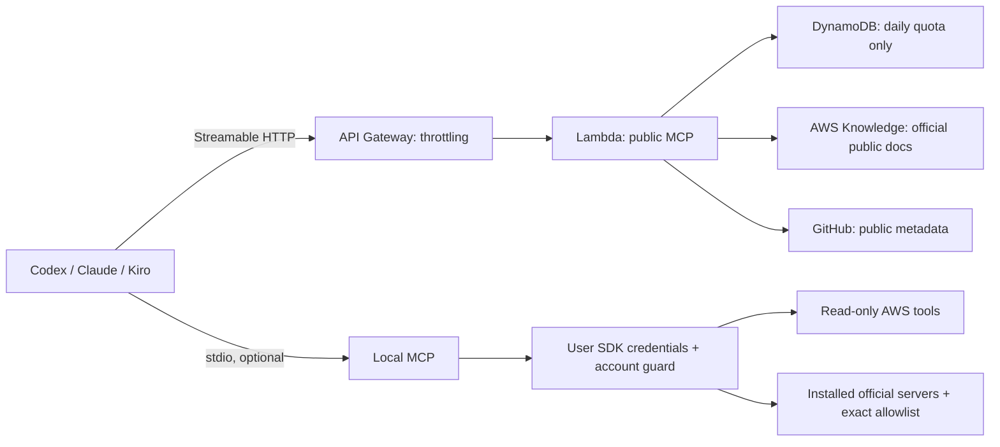

# Moretes AWS Architect MCP

**Arquitetura AWS com evidências, ferramentas abertas e decisões revisáveis.**

By [Fernando Azevedo](https://fernando.moretes.com) · MIT · Node.js 22.13+ · Streamable HTTP + stdio

Um workbench MCP para levantar requisitos, comparar alternativas, consultar a documentação oficial da AWS, desenhar arquiteturas, produzir ADRs e preparar a operação. O modelo do seu cliente (Codex, Claude ou Kiro) conduz o raciocínio; as ferramentas devolvem cálculos, estruturas, fontes e lacunas explícitas. O servidor não chama modelos pagos.

**English:** An evidence-first AWS architecture workbench for your MCP client. Deterministic design tools, live official AWS knowledge, a versioned integration catalog, and optional authenticated local AWS tooling. See [English guide](docs/README.en.md).

## Status and scope

| Capability | v0.1.0 |
|---|---|
| Architecture, calculations and static review | 16 tools |
| Live official AWS Knowledge | 5 adapters |
| Integration catalog/configuration and public GitHub | 3 tools |
| Authenticated local AWS identity, tagged inventory and cost history | 3 tools, opt-in |
| Official AWS MCP federation | 2 local dispatch tools, exact allowlist, opt-in |
| Official AWS catalog | 61 distinct entries in the snapshot |
| Version-pinned local configurations | 56 packages resolved from AWS source + PyPI |
| Prompts / resources | 4 workflows / 3 resources |

**24 public tools; up to 29 in explicitly enabled local mode.** A catalog entry is not a hosted integration, a tested provider, or a permission grant. The public deployment cannot operate your AWS account. Authenticated AWS access runs locally using your own credentials. This release does not provide remote account OAuth, multi-tenant delegated IAM, background jobs, or automatic deployment.

## Connect

The deployed endpoint and verification record are in [deployment.md](docs/deployment.md). Replace `<MCP_URL>` below with that URL.

```sh
# Codex
codex mcp add moretes-architect --url <MCP_URL>

# Claude Code
claude mcp add --transport http moretes-architect <MCP_URL>
```

Kiro configuration:

```json
{"mcpServers":{"moretes-architect":{"url":"<MCP_URL>","disabled":false,"autoApprove":[]}}}
```

No API key is needed for the public endpoint. It has a shared daily allowance; install locally for unrestricted local design calculations. See [client setup](docs/clients.md), including local Claude Desktop configuration.

## Run locally

```sh
git clone https://github.com/fernando-moretes/moretes-aws-architect-mcp.git
cd moretes-aws-architect-mcp
npm ci --ignore-scripts
npm test
npm run build
npm start                       # MCP stdio; do not expect a chat UI
# Or in another terminal:
npm run http                    # http://127.0.0.1:8787/mcp + landing page
```

`npm start` writes protocol messages to stdout only. Diagnostics belong on stderr. Node.js, your MCP client and optional `uv` are prerequisites. There is no npm registry release of this project yet; clone a tagged GitHub release.

## Use at work

> “Use o Moretes Architect. Preciso de uma API para processar pedidos. Pergunte primeiro sobre tráfego, dados, SLO e orçamento. Compare Lambda e ECS, pesquise a documentação AWS, faça o diagrama e um ADR com hipóteses e testes pendentes.”

> “Revise este desenho pelos seis pilares. Só marque um controle como atendido quando houver evidência. Mostre lacunas, responsável e critério de validação.”

> “Planeje um ensaio de falha depois de gravar no alvo, mas antes de registrar sucesso. Explique como reconciliar sem repetir o efeito.”

Do not send confidential architecture, secrets or customer data to the public service. Use local stdio for private design inputs; the AWS Knowledge and public GitHub tools still transmit their explicit queries externally. [Privacy and boundaries](SECURITY.md).

## Integrate official AWS servers

Use `integration_catalog` to discover servers by service/category, then `integration_config` for a pinned setup. Review the linked official prerequisites; packages have different permissions, dependencies, flags and costs. Generated Kiro configs start disabled with no auto-approved tools.

For a single local workbench, the optional federation bridge starts only version-pinned official packages already installed in the `uv` cache, after account verification. An owner-reviewed file lists exact tools permitted per provider. There is no public arbitrary proxy, shell tool, package installer or dynamic URL dispatcher. [Integration guide](docs/integrations.md).

## Architecture



The Lambda role can update only its quota table and write its own logs. No portfolio buckets, IAM administration, Bedrock invocation, STS delegation or application resource access. [Design](docs/architecture.md) · [Costs](docs/costs.md) · [Runbook](docs/operations.md).

## Quality and maintenance

```sh
npm run typecheck
npm test
npm run build
npm audit --omit=dev
npm run smoke -- <MCP_URL>        # makes a live, public AWS docs query
```

CI runs on Node 22 and 24. Offline tests exercise real MCP SDK initialization, tools, resources, prompts and stateless HTTP, along with negative input and isolation cases. Live tests are opt-in and are not implied by unit tests. [Validation record](docs/deployment.md).

- [Tool reference](docs/tools.md)
- [Workshop](docs/workshop.md)
- [Contributing](CONTRIBUTING.md)
- [Security](SECURITY.md)
- [Roadmap](ROADMAP.md)
- [Changelog](CHANGELOG.md)
- [Source attribution](NOTICE.md)

This independent project is not an AWS product, official Well-Architected review, security certification or guarantee of pricing. AWS and other product names belong to their respective owners.
