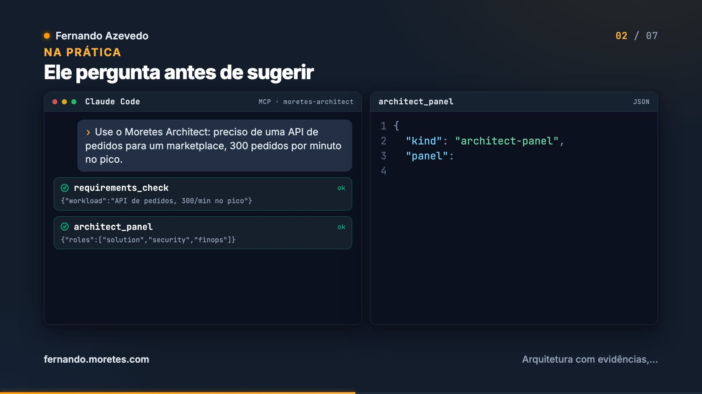
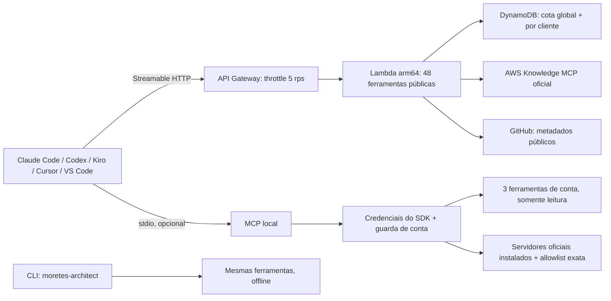

<p align="center">
  <picture>
    <source media="(prefers-color-scheme: dark)" srcset="docs/images/hero-dark.svg">
    
  </picture>
</p>

# Moretes Architect MCP

**Arquitetura com evidências, para qualquer nuvem, dentro do seu agente de código.**

Por [Fernando Azevedo](https://fernando.moretes.com) · AWS Community Builder (AI Engineering) · MIT · Node.js 22+ · Streamable HTTP + stdio · v0.2.0

Um servidor MCP que coloca **48 ferramentas determinísticas de arquitetura** e **10 personas de arquiteto** dentro do Claude Code, Codex, Kiro, Cursor, VS Code, Gemini CLI, Amazon Q e qualquer cliente MCP. O modelo do seu cliente raciocina; o servidor devolve cálculos, estruturas, fontes oficiais e lacunas explícitas. **O servidor nunca chama um modelo**, nunca acessa a sua conta pela internet e não precisa de chave de API.

**English:** evidence-first architecture workbench for your MCP client: architect personas, cloud-agnostic design tools, IaC/code/API reviews, AI-agent and MCP safety checks, live official AWS documentation, and a CLI for pipelines. See the [English guide](docs/README.en.md).

> Tutorial em vídeo, curso gratuito e FAQ em [fernando.moretes.com/mcp](https://fernando.moretes.com/mcp).

## Em 30 segundos

```sh
# Claude Code
claude mcp add --transport http moretes-architect https://m9od37vm41.execute-api.us-east-1.amazonaws.com/mcp

# Codex
codex mcp add moretes-architect --url https://m9od37vm41.execute-api.us-east-1.amazonaws.com/mcp

# Gemini CLI
gemini mcp add --transport http moretes-architect https://m9od37vm41.execute-api.us-east-1.amazonaws.com/mcp
```

Kiro (`.kiro/settings/mcp.json`), Cursor (`.cursor/mcp.json`), VS Code (`.vscode/mcp.json`) e Amazon Q:

```json
{"mcpServers":{"moretes-architect":{"url":"https://m9od37vm41.execute-api.us-east-1.amazonaws.com/mcp"}}}
```

O mesmo servidor responde em `https://fernando.moretes.com/api/mcp`, mas esse endereço passa pelo site e todos os seus usuários dividem uma única cota diária; use a URL direta acima para ter a sua. Sem chave, sem cadastro. Cota: 300 requisições por dia por cliente e 3.000 por dia no total; acima disso, `429`. Para uso sem cota e com entradas privadas, rode local (abaixo). Todos os clientes, passo a passo: [docs/clients.md](docs/clients.md).

Depois de conectar, peça ao agente:

> "Use o Moretes Architect. Preciso de uma API de pedidos para um marketplace, 300 pedidos por minuto no pico. Pergunte o que falta antes de sugerir, convoque os arquitetos de solução, segurança e FinOps, compare Lambda e ECS, desenhe o C4 e registre a decisão em um ADR."

<p align="center">
  
</p>

## O que ele faz

| Grupo | Ferramentas | Para quê |
|---|---|---|
| Personas e código | `architect_panel`, `code_review_architecture`, `dependency_manifest_review` | Convocar arquitetos de solução, enterprise, negócio, dados, infraestrutura, software, IA, segurança, governança e FinOps; revisar código e manifestos de dependência |
| Arquitetura e decisões | `requirements_check`, `architecture_pattern`, `service_compare`, `decision_record`, `well_architected_review`, `threat_model`, `failure_rehearsal`, `capacity_plan`, `cost_model`, `slo_budget`, `migration_plan`, `architecture_diagram`, `implementation_plan`, `agent_tool_contract` | Do requisito ao ADR, com os seis pilares, STRIDE, capacidade, custo datado e SLO |
| Design: diagramas, dados, contratos | `c4_model`, `sequence_diagram`, `service_equivalents`, `data_classification`, `openapi_review`, `event_contract` | C4 e sequência em Mermaid validados; equivalência AWS, Azure, GCP, OCI e open source em 43 capacidades; LGPD, GDPR e PCI como ponteiros; revisão de OpenAPI; contrato de evento CloudEvents |
| Confiabilidade, operação e FinOps | `latency_budget`, `queue_sizing`, `dr_strategy`, `retry_policy`, `storage_growth`, `finops_unit_economics`, `postmortem`, `runbook` | Orçamento de latência, Erlang C, RTO/RPO por tier de DR, backoff com jitter, crescimento de armazenamento, custo por unidade, postmortem e runbook |
| Agentes de IA e segurança de MCP | `agent_eval_plan`, `prompt_injection_checklist`, `rag_pipeline_plan`, `mcp_server_review`, `mcp_config_review` | Plano de avaliação, controles contra injeção, RAG com autorização antes do top-k, revisão de **outros** servidores MCP (tool poisoning, anotações, parâmetros perigosos) e da configuração do cliente |
| Revisão de IaC | `iam_policy_review`, `cloudformation_review`, `terraform_plan_review`, `kubernetes_manifest_review` | Plano Terraform/OpenTofu em JSON, template CloudFormation, manifestos Kubernetes, políticas IAM |
| AWS Knowledge ao vivo | `aws_knowledge_search`, `aws_knowledge_read`, `aws_regions`, `aws_regional_availability`, `aws_skill` | Documentação oficial atual, regiões e disponibilidade, pelo MCP oficial da AWS |
| Integrações oficiais e GitHub | `integration_catalog`, `integration_config`, `github_public_repository` | Catálogo dos 61 servidores oficiais awslabs com versão fixada; metadados públicos de repositórios |

Mais **20 prompts** (10 fluxos de trabalho e um `architect_<papel>` por persona), **18 resources** (`moretes://guide`, `moretes://boundaries`, `moretes://tools`, `moretes://personas/<id>`, `moretes://skills/<id>`) e, no modo local, **5 ferramentas opcionais** de conta AWS e federação com os servidores oficiais.

Cada ferramenta tem entrada estrita, saída estruturada, proveniência e limitações explícitas. As revisões são **heurísticas**: triagem para uma pessoa decidir, nunca certificação. Guia por ferramenta: [docs/tools-guide.md](docs/tools-guide.md) · Schemas: [docs/tools.md](docs/tools.md) · Saídas reais: [docs/examples](docs/examples) · Personas: [docs/personas.md](docs/personas.md).

## Por que existe

Os servidores MCP de nuvem são operacionais: executam na conta. Faltava a parte de antes: levantar requisitos, comparar com honestidade entre provedores, calcular em vez de chutar, revisar com evidências e registrar a decisão. Este projeto faz essa parte, no mesmo lugar onde o código nasce, sem custo de inferência no servidor e sem receber credenciais. Nasceu do meu trabalho como arquiteto e como AWS Community Builder no Brasil: o que eu uso para decidir, aberto para quem quiser usar, auditar e estender.

## No pipeline (CLI)

As mesmas ferramentas rodam offline, sem cliente MCP, com saída JSON, Markdown ou SARIF e código de saída por severidade:

```sh
git clone https://github.com/fernando-moretes/moretes-aws-architect-mcp.git
cd moretes-aws-architect-mcp && npm ci --ignore-scripts && npm run build

terraform show -json tfplan > plan.json
node dist/cli.js call terraform_plan_review --input plan.json --format sarif --fail-on high > review.sarif
# exit 0: ok · 1: achados no nível --fail-on ou acima · 2: erro de uso/entrada
```

Exemplos para GitHub Actions, GitLab CI e pre-commit: [docs/pipelines.md](docs/pipelines.md).

## Rodar local

```sh
npm ci --ignore-scripts && npm run build
npm start            # MCP stdio (protocolo no stdout; não é um chat)
npm run http         # http://127.0.0.1:8787/mcp + landing local
node dist/cli.js list
```

Claude Desktop e outros clientes stdio: `{"command":"node","args":["/CAMINHO/ABSOLUTO/dist/stdio.js"]}`. O modo local com conta AWS (identidade STS, inventário por tag, histórico de custo) e a federação com servidores oficiais são **opt-in por variável de ambiente e só existem no stdio**: o HTTP público nunca os expõe. Detalhes em [docs/clients.md](docs/clients.md) e [docs/integrations.md](docs/integrations.md). Ainda não há publicação no npm; use o clone de uma tag.

## Privacidade e limites

- O servidor público processa a entrada em memória e registra só id da requisição, status e duração. Nunca registra argumentos, prompts ou resultados.
- Só duas famílias de ferramentas saem para a internet: `aws_knowledge_*` (a consulta vai para o MCP oficial da AWS) e `github_public_repository` (api.github.com). Todo o resto é cálculo local.
- Não envie segredos, dados de clientes ou arquitetura confidencial ao endpoint público; para isso existe o modo local.
- Cota por cliente usa `sha256(dia + IP)`, com validade de dois dias; o IP bruto não é armazenado.
- Sem SLA. Serviço comunitário, mantido por uma pessoa, com orçamento alvo de US$ 30/mês.

Tudo em [PRIVACY.md](PRIVACY.md) e [SECURITY.md](SECURITY.md).

## Arquitetura



A role da Lambda só escreve na tabela de cota e nos próprios logs. Deploy por change set CloudFormation revisado. [Design](docs/architecture.md) · [Custos](docs/costs.md) · [Runbook](docs/operations.md) · [Evidências do deploy](docs/deployment.md).

## Qualidade

```sh
npm run typecheck && npm test && npm run build && npm audit --omit=dev
npm run smoke -- https://m9od37vm41.execute-api.us-east-1.amazonaws.com/mcp   # faz uma consulta pública real
node scripts/examples.mjs    # regenera docs/examples com as saídas reais
```

37 testes offline cobrem protocolo, cálculos, revisões, isolamento público/local, limites de entrada e federação. CI em Node 22 e 24.

## Documentação

[Clientes](docs/clients.md) · [Guia das ferramentas](docs/tools-guide.md) · [Personas](docs/personas.md) · [Pipelines](docs/pipelines.md) · [FAQ](docs/faq.md) · [Troubleshooting](docs/troubleshooting.md) · [Glossário](docs/glossary.md) · [Novidades](docs/whats-new.md) · [Workshop](docs/workshop.md) · [Integrações](docs/integrations.md) · [Contribuir](CONTRIBUTING.md) · [Roadmap](ROADMAP.md) · [Changelog](CHANGELOG.md) · [Atribuições](NOTICE.md)

Issues e PRs em português ou inglês são bem-vindos: proponha uma ferramenta com o template, descreva o problema, a entrada, a saída esperada e o limite. Uma ferramenta nova precisa de schema estrito, fronteira de dados externos explícita, limitações na saída e teste.

Projeto independente. Não é um produto da AWS, nem uma revisão Well-Architected oficial, nem certificação de segurança, nem cotação de preço. AWS e outros nomes pertencem aos seus donos.
