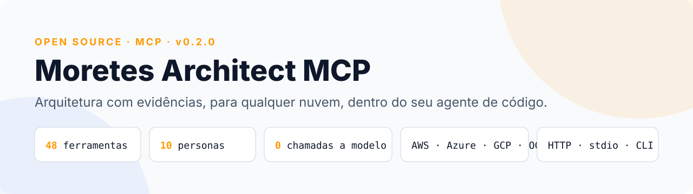
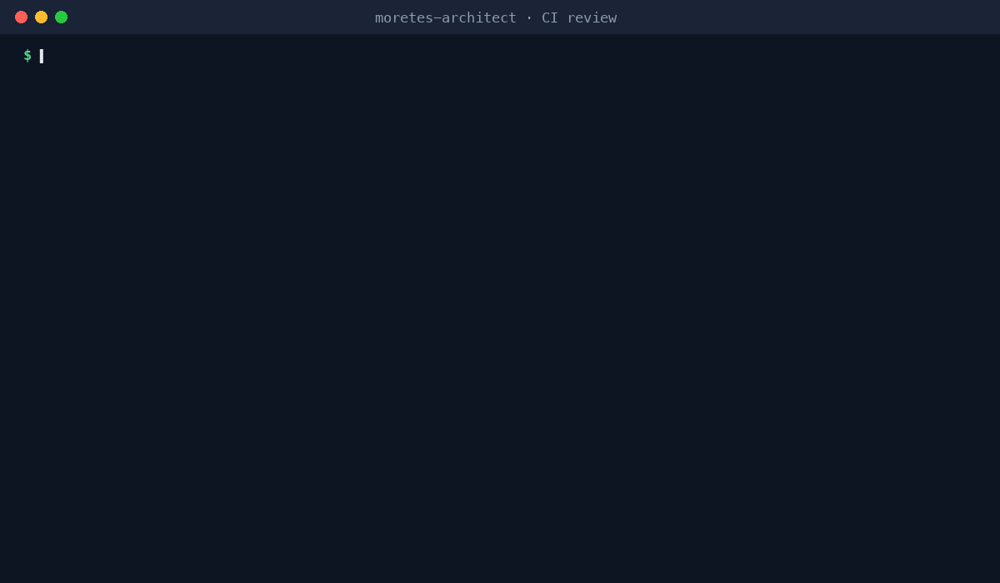
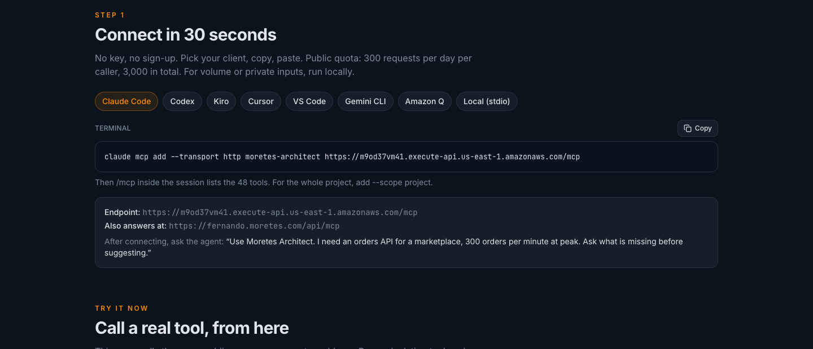
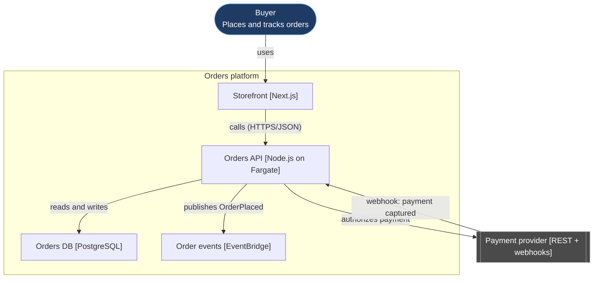
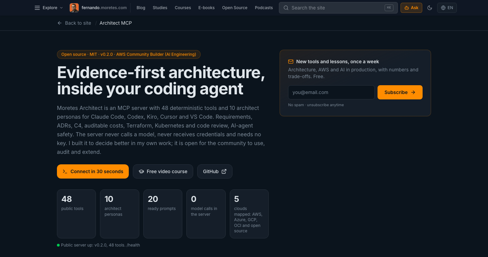
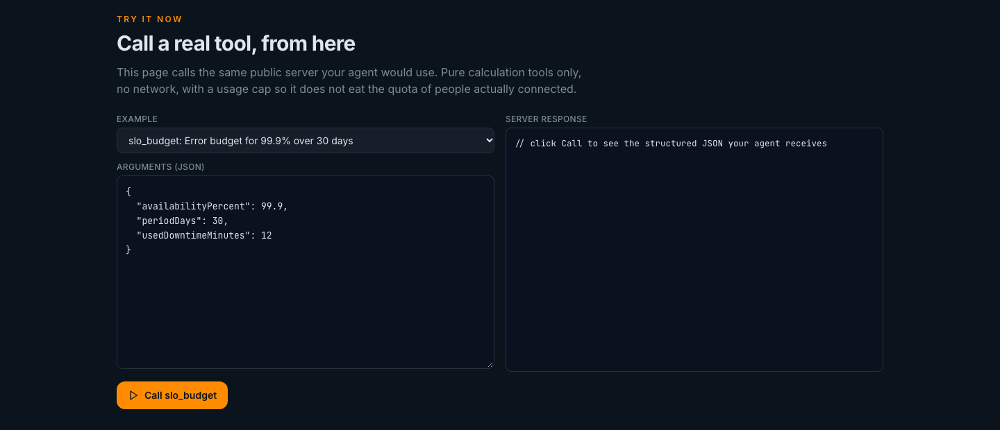
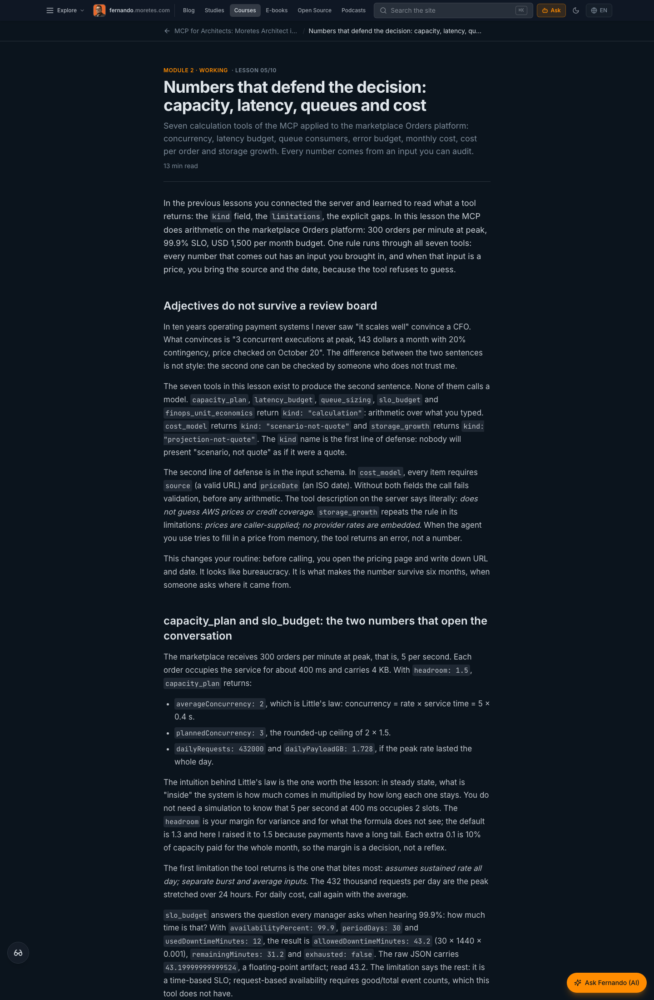
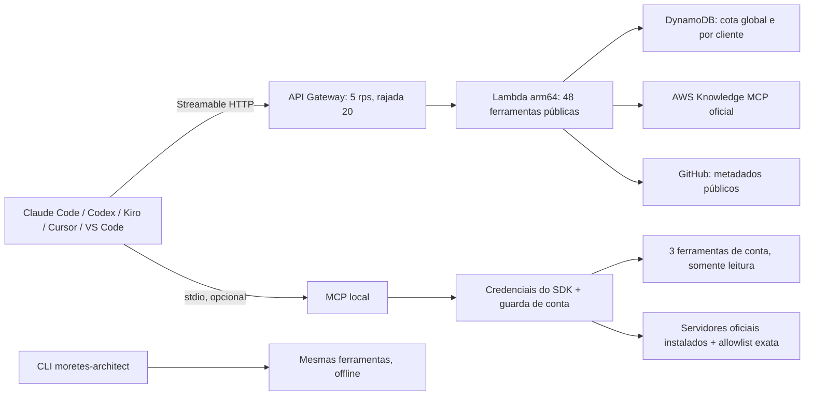
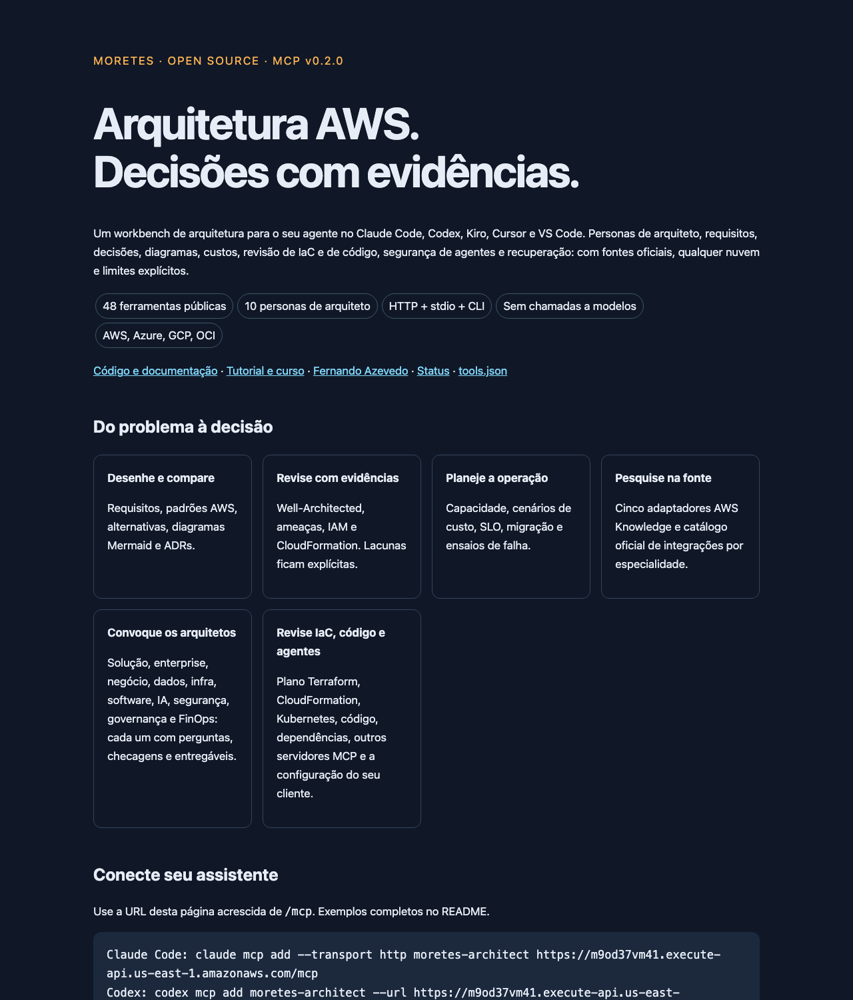

<p align="center">
  <picture>
    <source media="(prefers-color-scheme: dark)" srcset="docs/images/hero-dark.svg">
    
  </picture>
</p>

<p align="center">
  <a href="https://github.com/fernando-moretes/moretes-aws-architect-mcp/actions/workflows/ci.yml"></a>
  <a href="https://github.com/fernando-moretes/moretes-aws-architect-mcp/actions/workflows/codeql.yml"></a>
  <a href="https://registry.modelcontextprotocol.io/v0.1/servers?search=io.github.fernando-moretes/moretes-aws-architect-mcp"></a>
  <a href="LICENSE"></a>
  
  
  
  
  
  <a href="https://fernando.moretes.com/mcp"></a>
</p>

<p align="center">
  <b>Claude Code · Codex · Kiro · Cursor · VS Code · Gemini CLI · Amazon Q · Claude Desktop</b><br>
  <a href="#conecte-em-30-segundos">Conectar</a> ·
  <a href="#veja-funcionando">Ver funcionando</a> ·
  <a href="#o-que-ele-faz">Ferramentas</a> ·
  <a href="#no-pipeline">Pipeline</a> ·
  <a href="#privacidade-e-limites">Privacidade</a> ·
  <a href="https://fernando.moretes.com/mcp">Tutorial e curso</a> ·
  <a href="docs/README.en.md">English</a>
</p>

---

Um servidor MCP que coloca **48 ferramentas determinísticas de arquitetura** e **10 personas de arquiteto** dentro do seu agente de código. O modelo do seu cliente raciocina; o servidor devolve cálculos, estruturas, fontes oficiais e lacunas explícitas. **O servidor nunca chama um modelo**, nunca acessa a sua conta pela internet e não precisa de chave de API.

Feito por [Fernando Azevedo](https://fernando.moretes.com), Arquiteto de Tecnologia da Informação Especialista e AWS Community Builder (AI Engineering). É o que eu uso para decidir arquitetura no dia a dia, aberto para a comunidade usar, auditar e estender.

## Veja funcionando

**Pede uma API, ele pergunta antes de sugerir.** O agente chama `requirements_check` e depois `architect_panel`; nenhum número é inventado.

<p align="center">
  
</p>

**Calcula, não chuta.** No Kiro, `latency_budget` soma os passos em série, pega o maior dos paralelos e mostra onde o tempo vai.

<p align="center">
  
</p>

**Trava o apply perigoso no pipeline.** O mesmo motor roda offline como CLI, com Markdown, JSON ou SARIF e exit code por severidade.

<p align="center">
  
</p>

> Os GIFs são trechos dos vídeos do [curso gratuito](https://fernando.moretes.com/courses/mcp-architect-workbench), narrados na minha voz, com as chamadas e as respostas reais do servidor. Os JSON completos estão em [docs/examples](docs/examples).

## Conecte em 30 segundos

<p>
  <a href="https://cursor.com/en/install-mcp?name=moretes-architect&config=eyJ1cmwiOiJodHRwczovL205b2QzN3ZtNDEuZXhlY3V0ZS1hcGkudXMtZWFzdC0xLmFtYXpvbmF3cy5jb20vbWNwIn0="></a>
  <a href="https://insiders.vscode.dev/redirect/mcp/install?name=moretes-architect&config=%7B%22type%22%3A%22http%22%2C%22url%22%3A%22https%3A%2F%2Fmcp.moretes.com%2Fmcp%22%7D"></a>
</p>

Sem chave, sem cadastro:

```sh
# Claude Code
claude mcp add --transport http moretes-architect https://mcp.moretes.com/mcp

# Codex
codex mcp add moretes-architect --url https://mcp.moretes.com/mcp

# Gemini CLI
gemini mcp add --transport http moretes-architect https://mcp.moretes.com/mcp
```

<details>
<summary><b>Kiro, Cursor, VS Code, Amazon Q, Claude Desktop</b></summary>

Kiro (`.kiro/settings/mcp.json`), Cursor (`.cursor/mcp.json`) e Amazon Q (`mcp.json`):

```json
{
  "mcpServers": {
    "moretes-architect": {
      "url": "https://mcp.moretes.com/mcp",
      "autoApprove": []
    }
  }
}
```

VS Code (`.vscode/mcp.json`):

```json
{
  "servers": {
    "moretes-architect": { "type": "http", "url": "https://mcp.moretes.com/mcp" }
  }
}
```

Claude Desktop e qualquer cliente stdio, depois de [rodar local](#rodar-local):

```json
{ "mcpServers": { "moretes-architect": { "command": "node", "args": ["/CAMINHO/ABSOLUTO/dist/stdio.js"] } } }
```

Passo a passo de cada cliente, verificação e erros comuns: [docs/clients.md](docs/clients.md).
</details>

<p align="center">
  
</p>

Cota pública: **300 requisições por dia por cliente** e 3.000 no total; acima disso, `429`. O mesmo servidor responde em `https://fernando.moretes.com/api/mcp`, mas esse endereço passa pelo site e todos os seus usuários dividem uma única cota diária; use a URL direta para ter a sua. Para volume ou entradas privadas, [rode local](#rodar-local).

Depois de conectar, peça ao agente:

> "Use o Moretes Architect. Preciso de uma API de pedidos para um marketplace, 300 pedidos por minuto no pico. Pergunte o que falta antes de sugerir, convoque os arquitetos de solução, segurança e FinOps, compare Lambda e ECS, desenhe o C4 e registre a decisão em um ADR."

## O que ele faz

<p align="center">
  
</p>

| Grupo | Ferramentas | Para quê |
|---|---|---|
| **Personas e código** | `architect_panel`, `code_review_architecture`, `dependency_manifest_review` | Convocar arquitetos de solução, enterprise, negócio, dados, infraestrutura, software, IA, segurança, governança e FinOps; revisar código e manifestos de dependência |
| **Arquitetura e decisões** | `requirements_check`, `architecture_pattern`, `service_compare`, `decision_record`, `well_architected_review`, `threat_model`, `failure_rehearsal`, `capacity_plan`, `cost_model`, `slo_budget`, `migration_plan`, `architecture_diagram`, `implementation_plan`, `agent_tool_contract` | Do requisito ao ADR, com os seis pilares, STRIDE, capacidade, custo datado e SLO |
| **Design: diagramas, dados, contratos** | `c4_model`, `sequence_diagram`, `service_equivalents`, `data_classification`, `openapi_review`, `event_contract` | C4 e sequência em Mermaid validados; equivalência AWS, Azure, GCP, OCI e open source em 43 capacidades; LGPD, GDPR e PCI como ponteiros; OpenAPI; contrato CloudEvents |
| **Confiabilidade, operação e FinOps** | `latency_budget`, `queue_sizing`, `dr_strategy`, `retry_policy`, `storage_growth`, `finops_unit_economics`, `postmortem`, `runbook` | Orçamento de latência, Erlang C, tier de DR por RTO/RPO, backoff com jitter, crescimento de armazenamento, custo por unidade, postmortem e runbook |
| **Agentes de IA e segurança de MCP** | `agent_eval_plan`, `prompt_injection_checklist`, `rag_pipeline_plan`, `mcp_server_review`, `mcp_config_review` | Plano de avaliação, controles contra injeção, RAG com autorização antes do top-k, revisão de **outros** servidores MCP e da configuração do seu cliente |
| **Revisão de IaC** | `iam_policy_review`, `cloudformation_review`, `terraform_plan_review`, `kubernetes_manifest_review` | Plano Terraform/OpenTofu em JSON, CloudFormation, manifestos Kubernetes, políticas IAM |
| **AWS Knowledge ao vivo** | `aws_knowledge_search`, `aws_knowledge_read`, `aws_regions`, `aws_regional_availability`, `aws_skill` | Documentação oficial atual, regiões e disponibilidade, pelo MCP oficial da AWS |
| **Integrações oficiais e GitHub** | `integration_catalog`, `integration_config`, `github_public_repository` | Catálogo dos 61 servidores oficiais awslabs com versão fixada; metadados públicos de repositórios |

`iam_policy_review` lê política IAM da AWS, role definition do Azure e bindings do Google Cloud (`provider`). Toda ferramenta de cálculo e revisão publica `outputSchema`, e o cliente valida a saída.

Mais **20 prompts** (10 fluxos e um `architect_<papel>` por persona), **18 resources** (`moretes://guide`, `moretes://boundaries`, `moretes://tools`, `moretes://personas/<id>`, `moretes://skills/<id>`) e, só no modo local, **5 ferramentas opcionais** de conta AWS e federação com os servidores oficiais.

Guia de cada ferramenta: [docs/tools-guide.md](docs/tools-guide.md) · Schemas: [docs/tools.md](docs/tools.md) · Saídas reais: [docs/examples](docs/examples) · Personas: [docs/personas.md](docs/personas.md)

### Saída real: um C4 desenhado pelo `c4_model`

Entrada: pessoas, sistemas e relações explícitas. Saída: Mermaid validado (id duplicado, aresta solta e rótulo com sintaxe perigosa são recusados). O GitHub renderiza abaixo exatamente o que a ferramenta devolveu em [docs/examples/c4_model.json](docs/examples/c4_model.json):



### Saída real: revisando um servidor MCP envenenado

`mcp_server_review` recebe o `tools/list` de outro servidor e procura texto de instrução escondido na descrição, parâmetros perigosos, anotação mentirosa e nomes duplicados. Contra o servidor de exemplo em [docs/examples/mcp_server_review.json](docs/examples/mcp_server_review.json):

```json
{
  "summary": { "high": 5, "medium": 1, "info": 0 },
  "verdict": "Do not auto-approve; review each high finding with the server author or pin to an allowlist",
  "findings": [
    { "severity": "high", "target": "read_file", "message": "Description contains instruction-like text (references local secret files); tool-poisoning indicator." },
    { "severity": "high", "target": "read_file", "message": "Parameters that typically carry commands, raw queries, URLs or paths: path. Require an allowlist and per-call approval." }
  ]
}
```

## Por que existe

Os servidores MCP de nuvem são operacionais: executam na conta. Faltava a parte de antes: levantar requisitos, comparar com honestidade entre provedores, calcular em vez de chutar, revisar com evidências e registrar a decisão. Este projeto faz essa parte, no mesmo lugar onde o código nasce, sem custo de inferência no servidor e sem receber credenciais.

Três regras atravessam todas as ferramentas:

1. **Pergunta antes de assumir.** Requisito que falta volta como pergunta, não como valor típico.
2. **Calcula com entrada auditável.** Preço só com fonte e data; fórmula explícita na saída.
3. **Heurística é triagem.** Controle marcado como atendido sem evidência volta como desconhecido; toda revisão diz o que não cobre.

## No pipeline

```sh
git clone https://github.com/fernando-moretes/moretes-aws-architect-mcp.git
cd moretes-aws-architect-mcp && npm ci --ignore-scripts && npm run build

terraform show -json tfplan > plan.json
node dist/cli.js call terraform_plan_review --input plan.json --format sarif --fail-on high > review.sarif
# exit 0: ok · 1: achados no nível --fail-on ou acima · 2: erro de uso ou entrada
```

Roda offline e sem cota. O SARIF entra no code scanning do GitHub; o Markdown vai para o resumo do job. GitHub Actions, GitLab CI e pre-commit prontos em [docs/pipelines.md](docs/pipelines.md).

## Integrações

| Onde | Como |
|---|---|
| **Claude Code (plugin + skill)** | `/plugin marketplace add fernando-moretes/moretes-aws-architect-mcp` e `/plugin install moretes-architect@moretes` |
| **Gemini CLI** | `gemini extensions install https://github.com/fernando-moretes/moretes-aws-architect-mcp` |
| **Qualquer agente com Agent Skills** | `npx skills add fernando-moretes/moretes-aws-architect-mcp` |
| **GitHub Actions** | `uses: fernando-moretes/moretes-aws-architect-mcp@v0.4.0` com `tool`, `files`, `fail-on` e `sarif` |
| **pre-commit** | hooks `mcp-config-review`, `dependency-manifest-review`, `cloudformation-review`, `openapi-review`, `code-review-architecture` |
| **Docker** | `docker run -i --rm ghcr.io/fernando-moretes/moretes-aws-architect-mcp` (stdio), `... http`, `... cli check <ferramenta> <arquivo>` |

Detalhes e exemplos: [docs/integrations-clients.md](docs/integrations-clients.md).

## Rodar local

```sh
npm ci --ignore-scripts && npm run build
npm start            # MCP stdio (o protocolo usa o stdout; não é um chat)
npm run http         # http://127.0.0.1:8787/mcp e a landing local
node dist/cli.js list
```

As ferramentas de conta AWS (identidade STS, recursos por tag, histórico de custo) e a federação com os servidores oficiais são **opt-in por variável de ambiente e só existem no stdio**: o HTTP público nunca as expõe. Detalhes em [docs/clients.md](docs/clients.md) e [docs/integrations.md](docs/integrations.md). Ainda não há publicação no npm; use o clone de uma tag.

## Tutorial em vídeo e curso grátis

<p align="center">
  <a href="https://fernando.moretes.com/mcp"></a>
</p>

Em [fernando.moretes.com/mcp](https://fernando.moretes.com/mcp): conexão por cliente, um playground que chama o servidor de verdade, as ferramentas por grupo, as personas, troubleshooting e FAQ. O [curso](https://fernando.moretes.com/courses/mcp-architect-workbench) tem dez aulas, cada uma com vídeo, áudio e texto, quizzes e certificado:

<table>
  <tr>
    <td width="50%"></td>
    <td width="50%"></td>
  </tr>
  <tr>
    <td><sub>Playground: escolha um exemplo, edite o JSON, chame a ferramenta.</sub></td>
    <td><sub>Aula 05: números que defendem a decisão.</sub></td>
  </tr>
</table>

| # | Aula |
|---|---|
| 01 | O que é MCP e o que é o Moretes Architect |
| 02 | Conectar em 30 segundos: Claude Code, Codex, Kiro, Cursor e VS Code |
| 03 | Da ideia à decisão: requisitos, painel de arquitetos e ADR |
| 04 | Desenhar e contratar: C4, sequência, eventos e OpenAPI |
| 05 | Números que defendem a decisão: capacidade, latência, filas e custo |
| 06 | Revisar com evidências: Well-Architected, ameaças, dados e IAM |
| 07 | IaC e código no pipeline: Terraform, CloudFormation, Kubernetes e o CLI |
| 08 | Operar e recuperar: DR, retries, ensaio de falha, runbook e postmortem |
| 09 | Agentes de IA em produção e segurança de MCP |
| 10 | Personas, fontes oficiais, modo local e como contribuir |

## Privacidade e limites

- O servidor público processa a entrada em memória e registra só id da requisição, status e duração. Nunca argumentos, prompts ou resultados.
- Só duas famílias saem para a internet: `aws_knowledge_*` (a consulta vai para o MCP oficial da AWS) e `github_public_repository` (api.github.com). Todo o resto é cálculo local.
- A cota por cliente usa `sha256(dia + IP)` com validade de dois dias; o IP bruto não é guardado.
- Não envie segredos, dados de clientes ou arquitetura confidencial ao endpoint público; para isso existe o modo local.
- Sem SLA. Serviço comunitário, mantido por uma pessoa, com orçamento alvo de US$ 30 por mês.

Tudo em [PRIVACY.md](PRIVACY.md) e [SECURITY.md](SECURITY.md).

## Arquitetura



<details>
<summary><b>A landing do próprio servidor</b></summary>
<p align="center"></p>
</details>

A role da Lambda só escreve na tabela de cota e nos próprios logs. Deploy por change set CloudFormation revisado. [Design](docs/architecture.md) · [Custos](docs/costs.md) · [Runbook](docs/operations.md) · [Evidências do deploy](docs/deployment.md)

## Qualidade

```sh
npm run typecheck && npm test && npm run build && npm audit --omit=dev
npm run smoke -- https://mcp.moretes.com/mcp   # consulta pública real
node scripts/examples.mjs    # regenera docs/examples com as saídas reais
```

41 testes offline, 99% das linhas cobertas, cobrem protocolo, cálculos, revisões, isolamento entre público e local, limites de entrada e federação. CI em Node 22 e 24, CodeQL, Dependabot e SBOM CycloneDX a cada release. Cada saída documentada em `docs/examples` é um teste: se uma ferramenta mudar de comportamento, o CI acusa. `docs/tools.lock.json` guarda o hash do nome, da descrição e do schema de cada ferramenta, então qualquer mudança no que o modelo do cliente lê aparece no diff.

## Contribua

Issues e PRs em português ou inglês. Use os templates: [bug](.github/ISSUE_TEMPLATE/bug_report.yml) ou [proposta de ferramenta](.github/ISSUE_TEMPLATE/tool_proposal.yml) (problema, entrada, saída esperada, limite). Uma ferramenta nova precisa de schema estrito, fronteira de dados externos explícita, limitações na saída e teste. Se você é AWS Community Builder, organiza User Group ou dá aula: o curso e os vídeos são livres para usar em sala.

[Clientes](docs/clients.md) · [Ferramentas](docs/tools-guide.md) · [Personas](docs/personas.md) · [Pipelines](docs/pipelines.md) · [FAQ](docs/faq.md) · [Troubleshooting](docs/troubleshooting.md) · [Glossário](docs/glossary.md) · [Novidades](docs/whats-new.md) · [Workshop](docs/workshop.md) · [Contribuir](CONTRIBUTING.md) · [Conduta](CODE_OF_CONDUCT.md) · [Roadmap](ROADMAP.md) · [Changelog](CHANGELOG.md) · [Atribuições](NOTICE.md)

<sub>Projeto independente. Não é um produto da AWS, nem revisão Well-Architected oficial, nem certificação de segurança, nem cotação de preço. AWS e outros nomes pertencem aos seus donos.</sub>
